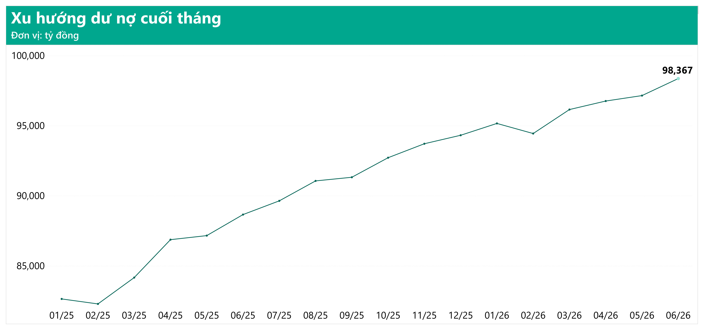
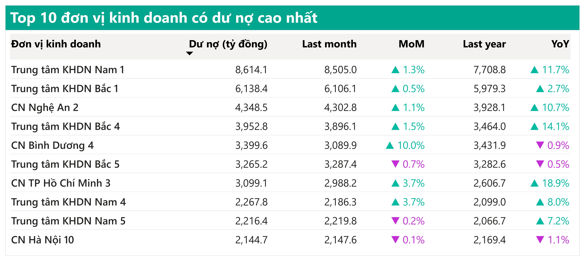

# Phân tích danh mục tín dụng KHDN – AIV Bank

**AI VIET NAM – eDA Conquer 2026 · Module 2 · Nhóm Datalyst**

Phân tích danh mục tín dụng Khối Khách hàng Doanh nghiệp (KHDN) của AIV Bank tại ngày báo cáo **30/06/2026**, trả lời ba câu hỏi của lãnh đạo Khối: quy mô và biến động dư nợ, nguồn thu nhập từ danh mục, và những khoản vay có dấu hiệu rủi ro.

## Thành viên nhóm

| STT | Họ và tên |
| --- | --- |
| 1 | Nguyễn Minh Việt |
| 2 | Trần Thị Khánh Huyền |
| 3 | Ngô Nguyễn Huy Khương |
| 4 | Lê Quốc Hùng |
| 5 | Nguyễn Duy Kiên |

## Kết luận chính (tại 30/06/2026)

- **Quy mô:** dư nợ đạt **98.367,3 tỷ đồng**, tăng 1,25% so với tháng trước và 10,95% so với cùng kỳ năm trước.
- **Chất lượng tín dụng:** tỷ lệ OD3-5 là **2,63%**, tăng 0,25 điểm phần trăm so với cuối tháng trước. Mức tăng này đến từ **một hợp đồng 390 tỷ đồng** (AIV-LN-0007842). Khi loại hợp đồng đó, tỷ lệ là 2,24%, thấp hơn cuối tháng trước 0,14 điểm phần trăm.
- **Dòng chuyển nhóm:** dư nợ OD2 giảm 31,6%, nhưng trong số dư nợ rời OD2 chỉ 42% trở về nhóm 1 và 51% chuyển sang OD3, nên mức giảm này chưa cho thấy chất lượng tín dụng cải thiện.
- **Thu nhập:** Micro và Small tạo **50,2% NII YTD**, trong khi MICRO cũng chiếm 23,6% dư nợ OD3-5 so với 20,20% tổng dư nợ.
- **Đề xuất ưu tiên:** (1) lập danh sách theo dõi các khoản lớn đang ở OD2 hoặc quá hạn từ 60 ngày; (2) báo cáo tỷ lệ OD3-5 kèm tỷ lệ khi loại khoản lớn nhất; (3) theo dõi hằng tháng dòng chuyển nhóm OD2 sang OD3, cùng NIM và tỷ lệ OD3-5 theo phân khúc.
- **Giới hạn:** dữ liệu chỉ có số dư cuối tháng và dòng chuyển nhóm mới phản ánh một tháng, nên chưa đủ để kết luận xu hướng hay nguyên nhân nghiệp vụ.

## Dashboard Power BI

Dashboard được xây dựng bằng Power BI, file nằm trong thư mục [`dashboard/`](dashboard/).

**Trang 1 – Overview**


**Trang 2 – Exposure**


**Trang 3 – NII & TOI**


**Trang 4 – Credit Quality**


## Một số hình trong báo cáo

**Q1 – Dư nợ và biến động**



*Hình 1: Dư nợ cuối tháng tăng từ 82.644 lên 98.367 tỷ đồng trong 18 tháng (01/2025–06/2026), chỉ giảm ở tháng 02/2025 và 02/2026.*



*Hình 2: Top 10 ĐVKD chiếm 40,10% tổng dư nợ tại 30/06/2026.*

**Q2 – Thu nhập từ danh mục**


*Hình 3: Micro và Small chiếm 50,2% NII YTD, nhưng Top 10 khách hàng có NII lớn nhất không có khách hàng Micro hay Small và chỉ chiếm khoảng 8,2% NII YTD.*


*Hình 4: NII YTD và TOI YTD đạt 802,5 và 1.165,5 tỷ đồng ở 06/2026. Đây là số lũy kế nên mức tăng so với tháng trước luôn dương.*


*Hình 5: Trung tâm KHDN Nam 1 (52,2 tỷ đồng) và CN Nghệ An 2 (42,7 tỷ đồng) dẫn đầu Top 10 ĐVKD theo NII YTD.*

**Q3 – Chất lượng tín dụng**


*Hình 6: Một hợp đồng 390 tỷ đồng tạo ra toàn bộ mức tăng 0,25 điểm phần trăm của tỷ lệ OD3-5.*


*Hình 7: Ba ngành chiếm 51,4% dư nợ OD3-5; Trung tâm KHDN Bắc 1 chiếm 21,2%.*


*Hình 8: Dư nợ OD2 giảm 429 tỷ đồng, nhưng chỉ 424 tỷ đồng trở về nhóm 1, trong khi 514 tỷ đồng chuyển sang OD3 và 594 tỷ đồng mới đi vào OD2.*

## Cấu trúc thư mục

```
.
├── report/       Báo cáo (LaTeX: main.tex, hình, tài liệu tham khảo) và bản PDF
├── slides/       Slide thuyết trình (.pptx)
├── dashboard/    Dashboard Power BI (.pbix)
├── data/         Dữ liệu gốc của dataset AIV Bank
├── docs/images/  Ảnh dùng cho README
└── README.md
```

## Dữ liệu

Dataset AIV Bank là dữ liệu giả lập theo mô hình star schema, gồm 10.000 khách hàng, 31.104 hợp đồng và 333.882 dòng `fact_loan_balance` với 31 ngày chốt cuối tháng (31/12/2023 đến 30/06/2026). Các bảng chính: `fact_loan_balance`, `fact_income_monthly`, `dim_loan_contract`, `dim_customer`, `dim_branch`, `dim_segment`, `dim_industry`, `dim_product`, `dim_date`. Dữ liệu nằm trong thư mục [`data/`](data/).

## Cách xem và biên dịch báo cáo

- **Xem nhanh:** mở file PDF trong thư mục [`report/`](report/).
- **Biên dịch lại:** dùng **pdfLaTeX** (bản TeX Live mới), biên dịch file `main.tex` trong thư mục `report/`. Các file `.cls`, `.sty`, `references.bib` và thư mục `Figures/` phải nằm cùng chỗ với file `.tex`. Có thể tải cả thư mục `report/` lên Overleaf để biên dịch.

## Thuật ngữ

| Thuật ngữ | Ý nghĩa |
| --- | --- |
| EOP | Dư nợ cuối kỳ tại một ngày chốt cuối tháng |
| DNBQ YTD | Dư nợ bình quân lũy kế từ đầu năm |
| NII | Thu nhập lãi thuần |
| TOI | Tổng thu nhập hoạt động (NII và thu nhập ngoài lãi) |
| MoM / YoY | So với tháng trước / so với cùng kỳ năm trước |
| OD2 | Dư nợ nhóm 2 (nợ cần chú ý) |
| OD3-5 | Dư nợ nhóm 3 đến nhóm 5 (nợ xấu) |
| ĐVKD | Đơn vị kinh doanh (chi nhánh, trung tâm KHDN) |
